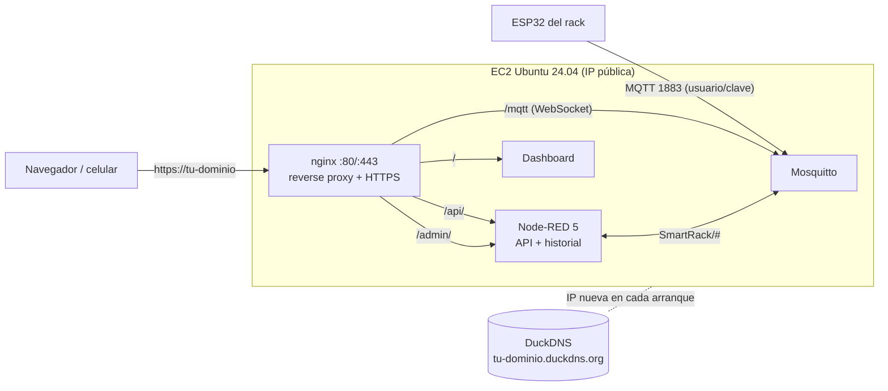

# SmartRack IoT · Servidor en la nube

Servidor con **IP pública**, **dominio** y **nginx como reverse proxy** para el rack monitoreable
(ESP32 + DHT11 + puerta + buzzer + LCD). Se crea solo en AWS en unos 10 minutos y se puede
volver a crear igual en cada sesión del laboratorio.



| Ruta | Qué es | Acceso |
|---|---|---|
| `https://DOMINIO/` | Dashboard del SmartRack | usuario/clave web (htpasswd) |
| `https://DOMINIO/admin/` | Editor de Node-RED | `admin` + clave de Node-RED, o cada administrador con su usuario y la contraseña de administradores |
| `DOMINIO:1883` | MQTT para el ESP32 | usuario/clave MQTT |
| `wss://DOMINIO/mqtt` | MQTT por WebSocket (MQTT Explorer, MQTTX) | usuario/clave web |
| `https://DOMINIO/salud` | Comprobación rápida | libre |

---

## ¿Por qué no importar una máquina virtual?

La idea de tener una VM lista e importarla tiene tres problemas en una cuenta de estudiante:

1. **VM Import/Export exige crear un rol IAM llamado `vmimport`**, y en AWS Academy no se pueden crear roles (solo existe `LabRole`).
2. La imagen tendría que vivir en un bucket S3. Si el entorno se borra al cerrar, también se borra el bucket, y subir varios GB más la conversión (30-90 min) en cada sesión de 4 horas no es práctico.
3. Una VM "congelada" queda desactualizada y nadie sabe exactamente qué tiene adentro.

**Lo que se hace aquí ("infraestructura como código"):** una plantilla de CloudFormation crea la red (VPC, subred, gateway, firewall) y la VM, y al arrancar la VM descarga este repositorio y ejecuta `instalar_smartrack.sh`, que aplica la guía del profesor paso a paso. Resultado: el mismo servidor, idéntico, en ~10 minutos y con un solo formulario. Además, como el script funciona en cualquier Ubuntu 24.04, también te sirve para una VM local (VirtualBox) o cualquier VPS.

> **Ojo:** el *AWS Academy Learner Lab* normalmente **sí conserva** los recursos entre sesiones (las instancias quedan detenidas y se vuelven a encender). Si tu curso usa ese laboratorio y se te borraban, revisa que no estés usando "Reset". Si lo conserva, despliega una vez y listo: el dominio se actualiza solo con la IP nueva en cada arranque.

---

## Contenido

```
smartrack-cloud/
├── instalar_smartrack.sh      ← instalador del servidor (la guía del profe, automatizada)
├── config.env.ejemplo         ← copiar a config.env y completar
├── aws/
│   ├── smartrack-stack.yaml   ← plantilla CloudFormation (VPC + EC2 + todo)
│   └── desplegar_aws.sh       ← opcional: crear/borrar todo con un comando
├── nodered/
│   ├── flows.json             ← backend: guarda historial/eventos y expone /api
│   └── settings.js            ← editor en /admin, login, solo escucha en local
├── dashboard/index.html       ← el dashboard (un solo archivo, sin librerías externas)
├── herramientas/              ← smartrack-estado, smartrack-simular, smartrack-https, ...
└── esp32/SmartRack_nube.ino   ← tu código con MQTT_HOST apuntando al dominio
```

---

## Preparación (una sola vez)

### 1. Dominio gratis en DuckDNS
1. Entra a <https://www.duckdns.org> con tu cuenta de Google o GitHub.
2. Crea un subdominio, por ejemplo `smartrack-grupo1` → `smartrack-grupo1.duckdns.org`.
3. Copia el **token** que aparece arriba de la página.

El servidor actualizará ese dominio con su IP pública cada vez que arranque (y cada 5 minutos).

### 2. Sube esta carpeta a GitHub
Crea un repositorio **público** (por ejemplo `smartrack-cloud`) y sube todo **excepto** `config.env`
(ya está en `.gitignore`). En el repositorio no va ninguna contraseña: las claves se escriben en
el formulario de AWS.

```bash
git init && git add . && git commit -m "SmartRack cloud"
git branch -M main
git remote add origin https://github.com/TU_USUARIO/smartrack-cloud.git
git push -u origin main
```

### 3. Ajusta el ESP32
En `esp32/SmartRack_nube.ino` (tu copia local, no la subas con tus claves):

```cpp
const char* WIFI_SSID     = "TU_RED_WIFI";
const char* WIFI_PASSWORD = "TU_CLAVE_WIFI";
const char* MQTT_HOST     = "smartrack-grupo1.duckdns.org";  // tu dominio
const char* MQTT_USER     = "fzeballos";                     // = MqttUsuario
const char* MQTT_PASSWORD = "UnaClaveNueva2026";             // = MqttClave
```

Es el único cambio. Como el ESP32 se conecta al **dominio** y no a una IP, no hay que reprogramarlo
cuando AWS cambie la IP.

---

## Crear el servidor (cada vez que lo necesites)

### Opción A · Consola de AWS (recomendada)
1. Inicia el laboratorio de AWS Academy y abre la consola (región **us-east-1**).
2. Ve a **CloudFormation → Crear pila → Con recursos nuevos**.
3. **Cargar un archivo de plantilla** → elige `aws/smartrack-stack.yaml`.
4. Nombre de la pila: `smartrack`. Completa el formulario:
   - **URL del repositorio**: `https://github.com/TU_USUARIO/smartrack-cloud.git`
   - **Dominio**, **Token de DuckDNS**, **Correo**
   - **Administradores Linux** (ya viene `frodriguez fpuma fzeballos atalavera`) y su **contraseña**
   - **Usuario/Clave MQTT** (los mismos del `.ino`), **clave del dashboard** y **clave de Node-RED**
   - Par de llaves: `vockey` (ya existe en AWS Academy; la llave es `labsuser.pem`)
5. Siguiente → Siguiente → **Enviar**. En 2-3 minutos la pila queda en `CREATE_COMPLETE`.
6. La pestaña **Salidas** muestra la IP y las URLs. La instalación sigue sola dentro de la VM
   **6-10 minutos más**; cuando termine, abre la URL del Dashboard.

Para ver el avance: EC2 → la instancia → **Conectar** (EC2 Instance Connect) y
`sudo tail -f /var/log/smartrack-instalacion.log`.
Al terminar verás un resumen con todas las URLs.

### Opción B · Un comando (AWS CLI)
Desde la terminal del laboratorio (ya tiene la CLI configurada) o tu PC con las credenciales de
"AWS Details":

```bash
cp config.env.ejemplo config.env && nano config.env   # completa todo, incluido REPO_GIT
./aws/desplegar_aws.sh          # crea la red, la VM y muestra las URLs
./aws/desplegar_aws.sh estado   # vuelve a mostrar las URLs
./aws/desplegar_aws.sh borrar   # elimina todo
```

### Opción C · Cualquier Ubuntu 24.04 (VM local, VPS, EC2 creada a mano)
```bash
git clone https://github.com/TU_USUARIO/smartrack-cloud.git && cd smartrack-cloud
cp config.env.ejemplo config.env && nano config.env
sudo ./instalar_smartrack.sh
```
Abre en el firewall/Security Group los puertos **22, 80, 443 y 1883**.

---

## Comprobar que todo funciona

```bash
smartrack-estado            # servicios, DNS, certificado, puertos y últimos datos del ESP32
sudo smartrack-simular      # simula el ESP32 (mismos tópicos) para probar sin hardware
```

- El dashboard debe pasar a **"ESP32 en línea"** apenas el ESP32 (o el simulador) publique.
- Botón **Apagar alarma** → publica `APAGAR` en `SmartRack/Control/Alarma` → el ESP32 la silencia.
- **Descargar CSV** baja el historial de las últimas 24 h.
- Para ver el dashboard sin servidor, abre `dashboard/index.html` directamente en el navegador:
  se activa el **modo demo** con datos simulados.

---

## Qué hace el instalador (y cómo se relaciona con la guía)

| Paso de la guía | En `instalar_smartrack.sh` |
|---|---|
| Crear usuario, sudo, `PermitRootLogin no` | Paso 2: crea **todos** los de `USUARIOS_SO` con sudo y contraseña, copia la llave `labsuser.pem`, bloquea root (SSH y contraseña) |
| Programas básicos, huso horario | Paso 1 (`tree wget nmap net-tools htop nano vim`…) |
| ufw | Paso 3: 22, 80, 443, 1883 (Node-RED **no** se expone) + **fail2ban** para el SSH con contraseña |
| Mosquitto | Paso 4, **con usuario y clave** (con IP pública, `allow_anonymous true` deja que cualquiera apague tu alarma) |
| Node.js | Paso 5: **Node 24**. La guía usa 20, pero Node-RED 5 exige Node ≥ 22.9 |
| Node-RED + `hash-pw` + `settings.js` | Paso 6: Node-RED 5 como servicio **systemd** (equivale a `pm2 start` + `pm2 save`) |
| nginx, `server_names_hash_bucket_size 64`, htpasswd, `/ui` y `/admin` | Pasos 7-8: `/` = dashboard con login, `/admin/` = editor |
| Let's Encrypt | Paso 10: `certbot --nginx --redirect`. Sin `--staple-ocsp` (Let's Encrypt apagó OCSP en 2025) |

No se instalan Django, PHP, MariaDB, phpMyAdmin ni Docker porque el SmartRack no los usa; si los
necesitas, agrégalos al final del script siguiendo la guía.

---

## Detalles importantes

**Límite de Let's Encrypt.** Se pueden emitir **5 certificados por semana para el mismo dominio**.
Cada servidor nuevo pide uno. Si vas a probar muchas veces seguidas, usa `CertbotPrueba = si`
(certificado de prueba) y cámbialo a `no` para la presentación. Si se alcanza el límite, el
servidor sigue funcionando por **HTTP** y luego basta `sudo smartrack-https`.

**HSTS desactivado a propósito.** Si lo activas y un día no sale el certificado, el navegador
se negará a abrir tu dominio por HTTP.

**Administradores.** Cada integrante entra con `ssh su_usuario@DOMINIO` y su contraseña (o con
`labsuser.pem`) y usa `sudo` para todo; `root` no puede entrar. Como el SSH con contraseña queda
expuesto a internet, fail2ban bloquea 1 hora la IP que falle 5 veces. Para entrar solo con llave
pon `SSH_CON_CLAVE="no"`. Node-RED corre con su propia cuenta de servicio (`nodered`) y sus
archivos están en `/var/lib/nodered/.node-red`.

**Contraseñas.** Solo letras, números y `_ . @ # % + = : , -` (así no rompen ningún comando).
Quedan en `/etc/smartrack/config.env` (solo root). Recuerda que los datos de usuario de una
instancia EC2 son visibles para quien tenga acceso a tu cuenta de AWS.

**Datos.** Node-RED guarda 24 h de historial (un punto cada 10 s) y los últimos 300 eventos en
disco. Si el laboratorio borra la VM, el historial se pierde: descarga el CSV antes de cerrar.

**Volver a ejecutar el instalador** es seguro: conserva las claves generadas y tus flujos de Node-RED
(salvo que pongas `ACTUALIZAR_FLOWS="si"`).

---

## Problemas frecuentes

| Síntoma | Qué revisar |
|---|---|
| El dominio no abre | `smartrack-estado` → ¿el DNS apunta a la IP? `sudo smartrack-duckdns` y revisa el token |
| Sale HTTP y no HTTPS | El DNS tardó o se alcanzó el límite semanal → `sudo smartrack-https` |
| SSH deja de conectar después de varios intentos fallidos | fail2ban bloqueó tu IP 1 h. Entra desde otra red o con la consola de AWS y ejecuta `sudo fail2ban-client set sshd unbanip TU_IP` |
| ESP32 no conecta (`Fallo MQTT, codigo: 5`) | Usuario/clave MQTT distintos a los del servidor |
| ESP32 no conecta (`codigo: -2`) | Puerto 1883 cerrado en tu red o dominio mal escrito |
| Dashboard "Sin conexión con el servidor" | `sudo systemctl status nodered` y `journalctl -u nodered -n 50` |
| La instalación falló | Lee `/var/log/smartrack-instalacion.log`, corrige `/etc/smartrack/config.env` y ejecuta `sudo bash /opt/smartrack-cloud/instalar_smartrack.sh` |

Tópicos MQTT que usa todo el sistema: los mismos del `.ino` (`SmartRack/Sensores/JSON`,
`SmartRack/Alarmas/Estado`, `SmartRack/Control/Alarma`, etc.).
